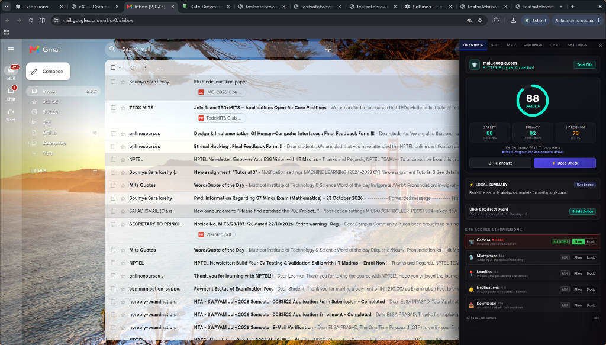
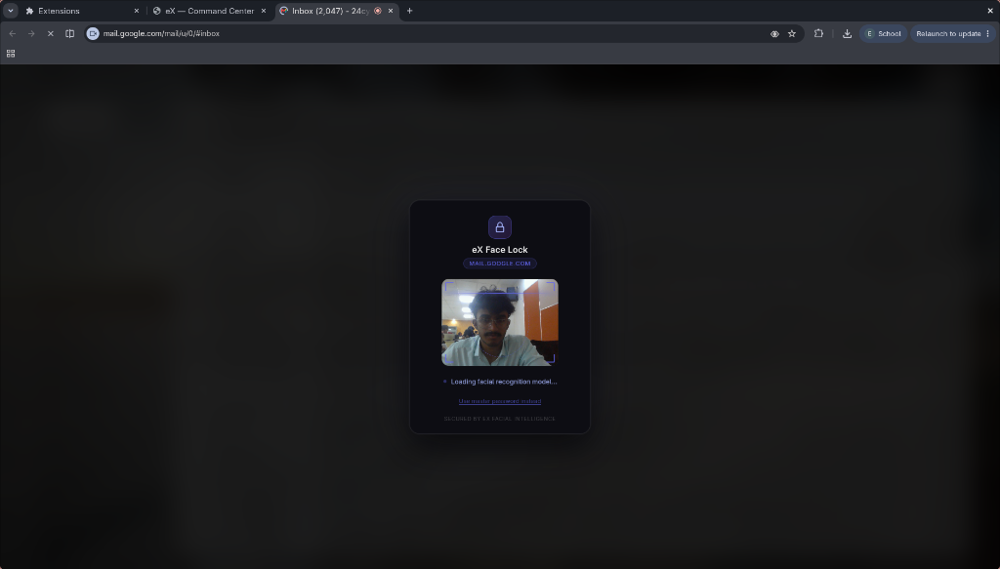
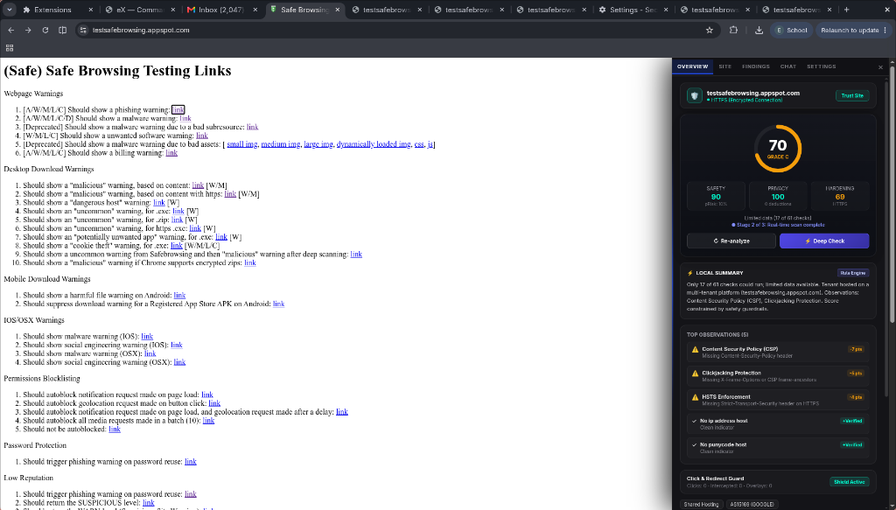
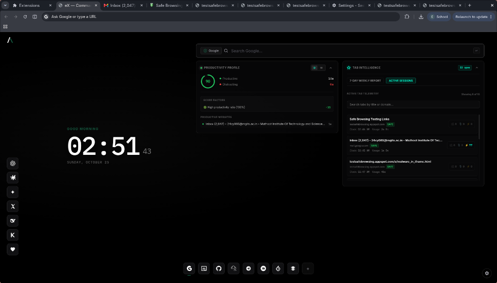
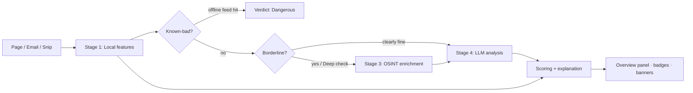

<div align="center">

# 🛡️ eX

### An AI-powered cyber-defense layer that lives in your browser.
**Phishing · Malicious sites · Ad-click hijacking · Permission abuse · Local-app vulnerabilities · Biometric lock**  
*Local-first. Explainable. Privacy-preserving.*

[](https://developer.chrome.com/docs/extensions/mv3/)
[](https://www.typescriptlang.org/)
[](https://build.nvidia.com/)
[](#privacy-design)
[](https://github.com/callme-ADHI)
[](#)

<br/>



</div>

---

## Table of contents

- [What is eX?](#what-is-ex)
- [Why it exists](#why-it-exists)
- [Screenshots & Visual Tour](#screenshots--visual-tour)
- [Feature tour](#feature-tour)
- [How it works](#how-it-works)
- [The eX Score](#the-ex-score)
- [Mail Guard (Gmail)](#mail-guard-gmail)
- [Click-hijack & ad-redirect detector](#click-hijack--ad-redirect-detector)
- [Site access monitor](#site-access-monitor)
- [Vulnerability engine (localhost)](#vulnerability-engine-localhost)
- [Face Lock](#face-lock)
- [AI layer: one model per task](#ai-layer-one-model-per-task)
- [OSINT & threat feeds](#osint--threat-feeds)
- [Privacy design](#privacy-design)
- [Threat model](#threat-model)
- [How eX compares](#how-ex-compares)
- [Install & run](#install--run)
- [Configuration & API keys](#configuration--api-keys)
- [Project structure](#project-structure)
- [Testing & evaluation](#testing--evaluation)
- [Known limitations](#known-limitations)
- [Roadmap](#roadmap)
- [Responsible use](#responsible-use)
- [Author](#author)

---

## What is eX?

**eX** is a Chrome extension that watches the places attackers actually reach you — your inbox, the sites you open, the permissions you grant, and the apps you build — and explains what it finds in plain language.

It combines fast local rules, offline threat feeds, OSINT enrichment and LLM reasoning in an escalation ladder: cheap local checks first, network and AI only when a case is genuinely ambiguous. Every verdict comes with the evidence that produced it.

> **eX is built around one idea:** a security tool should tell you *why*, not just show a number.

---

## Why it exists

| Problem | What users get today | What eX does |
| :--- | :--- | :--- |
| **Phishing emails look perfect** | A generic "suspicious" banner (or nothing) | Scores every inbox row, deep-scans opened mail, shows the top reasons with signed contributions |
| **Lookalike and malicious sites** | Blocklists that lag behind new domains | Local deception signals + reputation priors + OSINT + AI, per site, per tab |
| **Sites that hijack clicks for ads** | Nothing | Detects clicks that open popups/redirects and invisible overlays, offers a one-click pop-up block |
| **Silent camera/mic/location use** | Buried in browser settings | Live "in use" status with Allow/Block right in the panel |
| **Dev apps with hidden bugs** | Heavy scanners (proxy, Docker, config) | Zero-setup passive checks + a safe, confirmed active scan of your own localhost apps, with AI-written fixes |

---

## Screenshots & Visual Tour

<div align="center">

### Executive Defense Panel & Biometric Protection

| Overview & Telemetry | On-Device Face Lock |
| :---: | :---: |
|  |  |

| Multi-Tenant Sandboxing & Safe Browsing Evaluation | Focus Command Center |
| :---: | :---: |
|  |  |

</div>

---

## Feature tour

<table>
<tr>
<td width="50%" valign="top">

### 🧠 Site Intelligence
Every page gets an eX Score split into Safety, Privacy and Hardening, with confidence, evidence and an AI analysis that cites the exact signals it used.

</td>
<td width="50%" valign="top">

### ✉️ Mail Guard (Gmail)
Scans the first 50 Gmail inbox rows on load, then deep-scans each opened mail with ~70 features, local sender history, link intelligence and an LLM semantic pass.

</td>
</tr>
<tr>
<td valign="top">

### 🕵️ Click-Hijack Detector
Correlates real clicks with popups, redirects and invisible full-page overlays; shows a banner and can block pop-ups for the site.

</td>
<td valign="top">

### 🎛️ Site Access Monitor
Camera, Microphone, Location, Notifications, Downloads — current state, activity, and Allow/Block controls per site.

</td>
</tr>
<tr>
<td valign="top">

### 🔬 Vulnerability Engine
Passive checks on every site; a confirmation-based active scan restricted to localhost/private networks, with AI explanations and fix snippets, exportable as Markdown.

</td>
<td valign="top">

### 🔐 Face Lock
On-device facial verification gating chosen sites, with a hashed-PIN fallback and a management screen (add/remove sites, change password).

</td>
</tr>
<tr>
<td valign="top">

### 💬 AI Chat & Snip-to-Scan
Right-edge chat panel; select any screen region, offline OCR extracts the text, and it can be scanned for scams or sent to the assistant.

</td>
<td valign="top">

### 🧾 Explainability Everywhere
Signals are weighted, shown, and traceable. Where the LLM isn't used, eX says "Local summary" — it never pretends.

</td>
</tr>
</table>

---

## How it works



### Escalation ladder (cost and privacy aware):
1. **Local features** — URL, page, headers, cookies, behaviour. Instant, zero network.
2. **Offline feeds** — OpenPhish-style feeds and a bundled top-domains list matched locally, so no hostname leaves your machine.
3. **OSINT** — RDAP, DNS, certificate transparency, Wayback, ASN. Only for borderline sites or when you press *Deep check*.
4. **LLM analysis** — receives a compact evidence packet (never raw pages) and returns a structured, schema-validated analysis.

> **Fresh per tab:** Analysis state is keyed by tab and navigation; navigating discards old state, late async replies from older navigations are dropped, and switching tabs shows that tab's own results.

---

## The eX Score

The score separates *"is this site trying to deceive me?"* from *"is this site's configuration hardened?"* — because most legitimate sites miss some security headers, and that shouldn't make them untrustworthy to a visitor.

| Score | Answers | Main inputs |
| :--- | :--- | :--- |
| **Safety** | Is it trying to phish, scam, deceive or infect me? | Reputation prior, deception signals, feeds, OSINT, click behaviour |
| **Privacy** | How much does it track/fingerprint me? | Trackers, third parties, fingerprinting, session replay, ad networks |
| **Hardening** | How well is the site itself secured? | CSP, HSTS, clickjacking protection, cookies, CORS, SRI |

$$\text{eX Score} = 0.65 \times \text{Safety} + 0.25 \times \text{Privacy} + 0.10 \times \text{Hardening}$$
*(with dynamic risk caps, never above 97)*

### Safety model — transparent log-odds with a reputation prior:
$$z = \text{prior}(\text{tier}) + \sum w_i \cdot x_i$$
$$P_{\text{risk}} = \sigma(z) = \frac{1}{1 + e^{-z}}$$
$$\text{Safety} = 100 \times (1 - P_{\text{risk}})$$

- Priors come from popularity tier (bundled top-domains → Tranco rank tiers → unknown).
- Weights are stored in editable JSON and can be calibrated on benchmark datasets.
- Unknown signals contribute zero and reduce the displayed confidence (*"Based on N of 61 checks"*). Low coverage means limited-data warnings, not confident grades.
- Hardening findings are context-weighted: they only matter for login/payment pages, session cookies, or localhost.
- Shared hosting (e.g. `*.appspot.com`, `*.github.io`) is resolved with the Public Suffix List private section so a user subdomain never inherits the host's reputation.

---

## Mail Guard (Gmail)

A layered classifier with **~70 features across 8 distinct groups**:

| Group | Examples |
| :--- | :--- |
| **Sender identity** | Display-name/address mismatch, brand-in-name with unrelated domain, lookalike domains, reply-to mismatch |
| **Authentication cues** | Gmail's own warning banners, SPF/DMARC existence |
| **Language & intent** | Urgency, threats, credential/OTP/PIN requests, payment/KYC/UPI lures, prizes, secrecy, delivery fees, sextortion |
| **Links** | Text-vs-href mismatch, redirector unwrapping, shorteners, IP/punycode hosts, login-like paths on foreign domains, feed hits |
| **Attachments** | Executables, double extensions, HTML attachments, macro documents |
| **HTML structure** | Hidden text, embedded forms, image-only mail, tracking pixels |
| **QR / images** | Quishing: decoded QR URLs scored like links via offline worker |
| **Context** | Local sender history (domain counters only), bulk-mail markers |

- **Fusion:** deterministic features + LLM semantic features (category, impersonated entity, intent scores) → log-odds → probability → level (**High / Suspicious / Low-watch / Clean**) with top signed contributions shown to the user.
- **Regional patterns:** Built-in heuristics for bank KYC, UPI/PhonePe/Paytm, Aadhaar/PAN, India Post/courier fee scams.
- **Privacy:** Mail is analysed per message, never sent in full to the cloud, and redacted before any API call.

---

## Click-hijack & ad-redirect detector

Some sites turn the whole page into an ad trigger. eX detects it by correlating three sources:
1. **Click recorder (isolated world):** every trusted click, its target, and whether it was an actual link.
2. **Page hooks (main world):** `window.open`, script-triggered anchor clicks, global click handlers.
3. **Navigation correlation (service worker):** a new tab/redirect within ~1.5s of a click, to a different domain than the clicked link — or to a known ad/popunder network.
4. **Overlay scan:** invisible, full-viewport, high-z-index click catchers.

> False-positive guards skip legitimate `target=_blank` links, same-site navigation, OAuth/payment popups and downloads. When hijacking is confirmed, eX shows a banner, an AD badge, and a one-click **Block pop-ups on this site**.

---

## Site access monitor

Five rows, one clear control each:

| Capability | State | Activity | Control |
| :--- | :--- | :--- | :--- |
| 📷 **Camera** | Allowed / Blocked / Ask | In use / Idle | Allow · Block |
| 🎙️ **Microphone** | Allowed / Blocked / Ask | In use / Idle | Allow · Block |
| 📍 **Location** | Allowed / Blocked / Ask | In use / Idle | Allow · Block |
| 🔔 **Notifications** | Allowed / Blocked / Ask | In use / Idle | Allow · Block |
| 📥 **Downloads** | Allowed / Blocked / Ask | last download | Allow · Block |

Controls use Chrome's `contentSettings` API per site; blocking also stops live tracks immediately. Capabilities the browser can't control (or incognito) are labelled honestly instead of showing fake buttons. A separate line displays when eX's own Face Lock camera is active.

---

## Vulnerability engine (localhost)

Deterministic rules find and confirm bugs. The LLM only prioritises and explains. It never writes free-form exploits.

**Stages:** passive harvest → stack fingerprint → declarative rule engine → AI endpoint ranking → safe differential probes → mandatory confirmation → scoring (CWE/OWASP mapping) → batched AI explanation with fixes.

### Active probes (localhost/private IPs only, rate-limited, capped):
- Exposed files (`.env`, `.git/HEAD`, backups, debug routes) with signature matching
- Directory listing, verbose errors / stack traces
- Reflected input via benign canary, with context classification
- SQL error leakage and boolean differential checks (no time-based probes)
- Open redirect, safe path-traversal probe
- CORS origin reflection, dangerous HTTP methods
- IDOR candidates listed for manual review, never exploited

> A finding is only reported if a second probe with a fresh canary reproduces it and a control request does not. Reports export directly to Markdown.

---

## Face Lock

- **On-device verification:** 512-dimensional face embeddings, cosine similarity, configurable threshold. Camera frames are never stored or sent anywhere.
- **Gated sites you choose:** manage everything from the home panel: add/remove/edit sites, change password.
- **PIN fallback:** after repeated failures; stored only as a salted PBKDF2 hash (SHA-256, 150k iterations).
- **Explicit state machine:** `requesting` → `ready` → `loading model` → `scanning` → `matched` / `failed` / `denied` / `timeout` with Retry and Use password options.

---

## AI layer: one model per task

All AI calls go through a single router to NVIDIA NIM (OpenAI-compatible endpoint). Each task uses a model suited to it, configured in `models.config.json`:

| Task | Purpose | Model class | Default Model |
| :--- | :--- | :--- | :--- |
| `chat` | Assistant, page Q&A | Large general instruct | `meta/llama-3.1-70b-instruct` |
| `mailBatch` | Fast triage of 50 inbox rows in 1–2 calls | Small fast instruct | `meta/llama-3.1-8b-instruct` |
| `mailDeep` | Semantic features for an opened mail | Mid/large instruct | `meta/llama-3.1-70b-instruct` |
| `sitePhish` | Compact site verdicts | Small/mid instruct | `meta/llama-3.1-8b-instruct` |
| `vuln` | Endpoint ranking, explanations, fixes | Code-capable model | `meta/codellama-70b-instruct` |

**Safety rails:** queue with concurrency limits and backoff, JSON-schema validation with retry, citation checks on AI analyses (must reference real evidence IDs), and graceful fallback to deterministic results.

---

## OSINT & threat feeds

| Source | Used for |
| :--- | :--- |
| **RDAP** | Domain age, registrar, expiry |
| **Google Public DNS (DoH)** | MX / SPF / DMARC / CAA, TTL, NS |
| **Certificate Transparency** | First-seen certificate, SAN lookalikes (crt.sh / Cert Spotter) |
| **Internet Archive** | Site history depth |
| **RIPEstat** | ASN, hosting country |
| **AlienVault OTX** | Threat-report pulses |
| **Tranco** | Popularity tier (bundled top-100k for offline use) |
| **OpenPhish-style feeds** | Offline, local matching |
| **URLhaus / Safe Browsing** | Optional, bring-your-own free key |

---

## Privacy design

- **Local-first:** rules, scoring, feeds and face verification run on your device.
- **Cloud AI is opt-in, escalation-only, and receives redacted, compact evidence** (emails, phone numbers, tokens, card-like numbers removed; domains instead of addresses).
- **"What is sent to AI" preview** in Settings shows the last payload per task.
- **No analytics, no telemetry, no accounts;** one-click clear-all-data.
- **Mail history** stores sender domains and counters only.

---

## Threat model

| Threat (STRIDE) | Example | eX control |
| :--- | :--- | :--- |
| **Spoofing** | Lookalike login, fake sender, photo at face lock | URL/page/mail models, brand maps, PIN fallback, state machine |
| **Tampering** | Form hijack, clipboard/click hijack | Form-action checks, click-hijack detector |
| **Repudiation** | "What did it block?" | Local activity timeline |
| **Information disclosure** | PII to cloud, key leakage | Redaction, consent, offline feeds, hostname-leak controls |
| **Denial of service** | API rate limits | Local-first scoring, caching, backoff |
| **Elevation of privilege** | Hostile page attacking the extension | Message validation, Shadow DOM, no `eval`, no `innerHTML` with untrusted data |
| **Prompt injection** | "Ignore your rules" inside an email | Data-wrapping, schema-only outputs, citation validation |

---

## How eX compares

| Tool | Approach | Strength | Trade-off |
| :--- | :--- | :--- | :--- |
| **OWASP ZAP** | Proxy + spider + scanners | Free, comprehensive, passive & active | Setup, slow active scans, SPA/auth friction |
| **Nuclei** | Template engine | Fast, precise, huge template library | Tests given targets; no discovery |
| **Nikto** | Server checks | Quick server misconfig audit | Not application-level |
| **Phishing extensions** | Email/site classifiers | Convenient | Usually single-purpose, black-box verdicts |
| **eX** | Browser-resident, tiered, explainable | Zero-setup, real logged-in session, bundles phishing + privacy + permissions + local-app scanning + biometrics | Smaller rule set than dedicated scanners; no network/TLS-level checks |

---

## Install & run

### Requirements
- **Node.js 18+**
- **Chrome / Chromium** (recent)
- **NVIDIA API key(s)** (free tier available at [build.nvidia.com](https://build.nvidia.com/))

```bash
git clone https://github.com/callme-ADHI/eX.git
cd eX
npm install
cp background/keys.example.js background/keys.js # then add your keys
npm run build
```

### Load in Chrome:
1. Open `chrome://extensions`
2. Enable **Developer mode** (top right)
3. Click **Load unpacked**
4. Select the `dist/` directory inside `eX`
5. Pin the extension and configure your Face Lock password!

---

## Configuration & API keys

```javascript
// background/keys.js (gitignored — never commit)
export const KEYS = {
  KEY_1: "nvapi-...", // chat
  KEY_2: "nvapi-...", // mail detection
  KEY_3: "nvapi-...", // site analysis + vulnerability explanation
};
```

One NVIDIA key works for all hosted models; separate keys just spread rate limits. Keys can also be configured and overridden directly inside the extension's Settings UI.

```bash
node tools/list-models.mjs       # list models your key can access
node tools/ping-model.mjs chat   # test chat model task end-to-end
node tools/check-osint.mjs       # test OSINT endpoint connectivity
```

---

## Project structure

```
eX/
├── background/         # Service worker entry, keys, router, state, cache
├── docs/screenshots/   # UI screenshots and walk-through captures
├── public/             # Extension manifest, face-api models, OCR assets
├── src/
│   ├── background/     # Background orchestration, OSINT, permissions
│   ├── content/        # UI panels, Shadow DOM injectors, hooks
│   │   ├── SidePanel/  # Overview tab, permission monitor, tabs
│   │   └── gmail/      # Mail Guard inbox & thread inspection
│   └── detectors/      # Scoring engines, heuristics, PSL, vulnerability checks
├── tests/              # E2E Puppeteer suites, mail corpus, unit tests
├── tools/              # Model verification, test runners, benchmark scripts
├── models.config.json  # Task-to-NVIDIA-model mappings
└── vite.*.config.ts    # Bundling configurations for MV3 targets
```

---

## Testing & evaluation

```bash
npm run build
bash tools/verify.sh                          # Syntax, manifest, forbidden patterns, unit tests & E2E
node --test tests/unit/distribution.test.js  # Score distribution checks
node tools/eval-mail.mjs                      # Mail classifier evaluation suite
```

---

## Responsible use

- **Defensive purpose:** eX is engineered exclusively as a defensive security companion.
- **Scope restriction:** The active vulnerability scanner is strictly confined to `localhost` and private RFC-1918 addresses behind explicit user confirmation dialogs.
- **Responsible testing:** Always verify phishing indicators on safe reference testbeds (e.g. Google Safe Browsing test endpoints) rather than interacting with active malicious servers.

---

## Author

**Adhithyakrishna R. (Adhi)**  
B.Tech CSE (Cybersecurity), MITS Kochi  
GitHub: [@callme-ADHI](https://github.com/callme-ADHI)

*Built for an AI for Cybersecurity hackathon: practical threat modelling, vulnerability detection, phishing defense and privacy-preserving workflows.*

<div align="center">

**If eX helped you spot something suspicious, give it a ⭐!**

</div>
